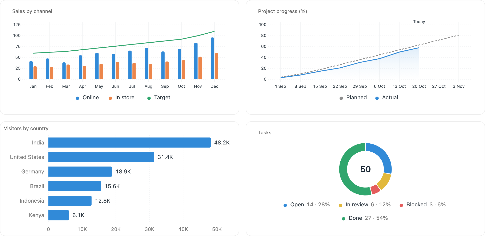

<div align="center" markdown="1">


<h1>Frappe Charts</h1>

**Simple, modern SVG charts for the web, with zero dependencies**

[](https://github.com/frappe/charts/actions/workflows/publish.yml)
[](https://www.npmjs.com/package/frappe-charts)
[](https://bundlejs.com/?q=frappe-charts)

[Live demos](https://frappe.io/charts)



</div>

## Frappe Charts

Frappe Charts is a small charting library with a simple API. It started as the sales graph in [ERPNext](https://github.com/frappe/erpnext) and is now used for charts across the [Frappe Framework](https://github.com/frappe/frappe).

### Key Features

- **Chart types**: bar, horizontal bar, line, mixed axis, donut, pie, percentage and heatmap.
- **Axis charts**: stacked bars, rounded bars, smooth or dashed lines, gaps in lines, region fill, X and Y markers and Y regions.
- **Tooltips**: one tooltip per column with every series in it, with your own number format.
- **Donut**: a total or your own value in the center, and `onClick` for slices and legend items.
- **Live data**: add, remove or replace data points, and the chart animates to the new shape.
- **Theming**: colors and lines come from CSS variables such as `--charts-label-color`, so dark mode is a few lines of CSS.
- **Export**: save any chart as an SVG file.

## Usage

```bash
npm install frappe-charts
```

```js
import { Chart } from 'frappe-charts';
import 'frappe-charts/dist/frappe-charts.min.css';
```

Or load it in the browser:

```html
<link rel="stylesheet" href="https://unpkg.com/frappe-charts/dist/frappe-charts.min.css">
<script src="https://unpkg.com/frappe-charts/dist/frappe-charts.umd.js"></script>
<!-- the browser build exposes window['frappe-charts'].Chart -->
```

```js
const chart = new Chart('#chart', {
  title: 'Sales by channel',
  type: 'axis-mixed', // or 'bar', 'line', 'donut', 'pie', 'percentage', 'heatmap'
  height: 250,
  colors: ['#318ad8', '#30a66d'],
  data: {
    labels: ['Jan', 'Feb', 'Mar', 'Apr', 'May', 'Jun'],
    datasets: [
      { name: 'Online', chartType: 'bar', values: [42, 48, 39, 55, 61, 58] },
      { name: 'Target', chartType: 'line', values: [60, 62, 64, 68, 72, 76] }
    ],
    yMarkers: [{ label: 'Goal', value: 70 }]
  }
});

chart.addDataPoint('Jul', [66, 80]);
chart.export();
```

For a horizontal bar chart, use `type: 'bar'` with `barOptions: { horizontal: 1 }`.

## Development Setup

* `yarn install`
* `yarn watch` - Build on every change
* `yarn build` - Build `dist`
* `yarn test` - Run the Playwright tests (run `yarn playwright install chromium` once first)
* Commit messages follow [Conventional Commits](https://www.conventionalcommits.org). A merge to `master` runs the tests and publishes a new version to npm.

## Links

- [Release notes](https://github.com/frappe/charts/releases), and [older updates](CHANGELOG.md)
- [So we decided to create our own charts](https://medium.com/@pratu16x7/so-we-decided-to-create-our-own-charts-a95cb5032c97)

<br>
<br>
<div align="center" style="padding-top: 0.75rem;">
	<a href="https://frappe.io" target="_blank">
		<picture>
			<source media="(prefers-color-scheme: dark)" srcset="https://frappe.io/files/Frappe-white.png">
			
		</picture>
	</a>
</div>
